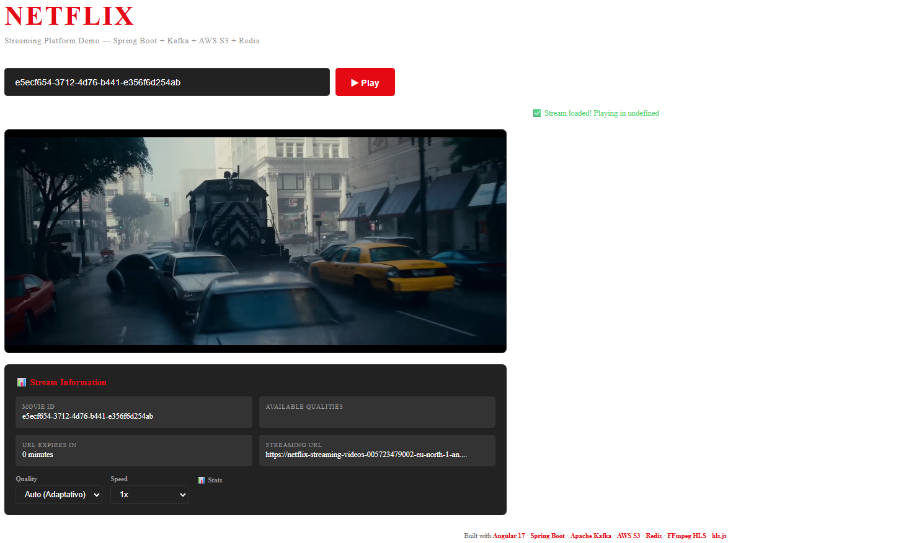
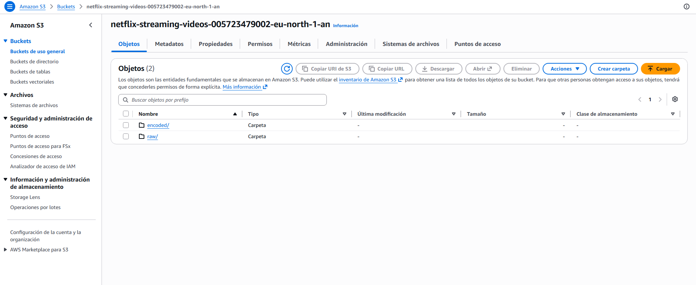
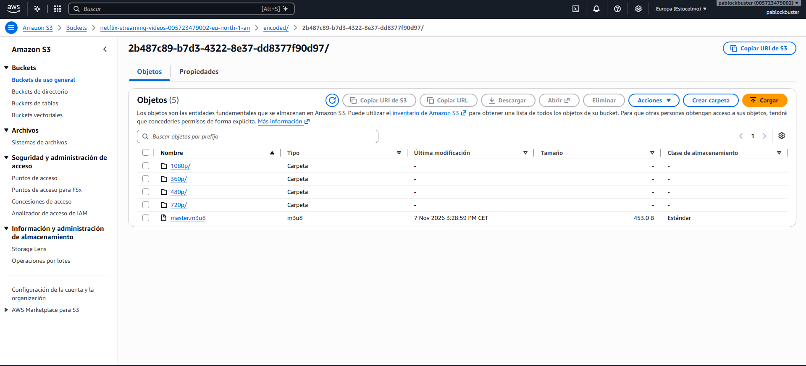

# 🎬 NETFLIX-APP - Streaming Platform Microservices

> A complete video streaming platform built with a microservices architecture using Spring Boot, Kafka, AWS S3, Redis, MySQL, and Angular.

<div align="center">


</div>

---
```mermaid
graph TB
    subgraph Client
        NG[Netflix Client<br/>Angular 17<br/>Port 4200]
    end

    subgraph API_Gateway[Edge Services]
        CS[Content Service<br/>Spring Boot<br/>Port 8081]
        VS[Video Service<br/>Spring Boot<br/>Port 8082]
        ES[Encoding Service<br/>Spring Boot<br/>Port 8083]
        SS[Streaming Service<br/>Spring Boot<br/>Port 8084]
    end

    subgraph Data_Storage[Data Layer]
        MYSQL[(MySQL 8.0<br/>Movie Catalog<br/>Port 3306)]
        REDIS[(Redis<br/>Streaming Cache<br/>Port 6379)]
        S3[/AWS S3<br/>Video Storage/]
    end

    subgraph Messaging[Event Bus]
        KAFKA[(Apache Kafka<br/>Event Streaming<br/>Port 9092)]
        ZK[(Zookeeper<br/>Port 2181)]
    end

    NG -.->|HTTP REST| CS
    NG -.->|HTTP REST| VS
    NG -.->|HTTP REST| SS

    CS -->|Kafka: video.uploaded<br/>video.encoded| KAFKA
    VS -->|Kafka: video.uploaded| KAFKA
    ES -->|Kafka: video.encoded| KAFKA
    SS -->|Kafka: video.encoded| KAFKA

    CS -->|JDBC| MYSQL
    SS -->|Redis| REDIS
    VS -->|S3 API| S3
    ES -->|S3 API| S3
    SS -->|S3 API| S3

    KAFKA <--> ZK

    classDef client fill:#e1f5fe,stroke:#01579b,stroke-width:2px
    classDef service fill:#e8f5e9,stroke:#1b5e20,stroke-width:2px

---

## 🔄 Event Flow

```mermaid
sequenceDiagram
    participant Client as Netflix Client
    participant CS as Content Service
    participant VS as Video Service
    participant K as Kafka
    participant ES as Encoding Service
    participant SS as Streaming Service
    participant S3 as AWS S3
    participant Redis as Redis Cache
    participant MYSQL as MySQL

    Client->>CS: POST /api/v1/movies (add movie)
    CS->>MYSQL: INSERT movie (status: PENDING)
    CS-->>Client: 201 Created + movieId

    Client->>VS: POST /api/v1/videos/upload/{movieId} (multipart file)
    VS->>S3: Upload raw video
    VS->>K: Publish video.uploaded event
    VS-->>Client: 200 OK + S3 key

    K->>ES: Consume video.uploaded
    ES->>S3: Download raw video
    ES->>ES: FFmpeg encode (HLS)
    ES->>S3: Upload encoded segments + master.m3u8
    ES->>K: Publish video.encoded event

    K->>SS: Consume video.encoded
    SS->>Redis: Cache master playlist key
    
    K->>CS: Consume video.encoded
    CS->>MYSQL: Update hlsUrl & status

    Client->>SS: GET /api/v1/stream/{movieId}
    SS->>Redis: Get cached playlist key
    SS->>S3: Generate signed URL
    SS-->>Client: 200 OK + signed streaming URL
    
    Client->>SS: GET /api/v1/stream/{movieId}/playlist?path=...
    SS->>S3: Fetch m3u8 playlist
    SS-->>Client: Signed playlist content
```

---

### 3. Configure AWS Credentials

Create or update `application.yml` in each service with your AWS credentials:

```yaml
aws:
  access-key: YOUR_AWS_ACCESS_KEY
  secret-key: YOUR_AWS_SECRET_KEY
  region: eu-north-1
  s3:
    bucket-name: your-s3-bucket-name
```

### 4. Build and Run Each Microservice

```bash
# Content Service
cd content-service
./mvnw spring-boot:run

# Video Service
cd video-service
./mvnw spring-boot:run

# Encoding Service

## 📦 Microservices

| Service | Port | Description | Key Technologies |
|---------|------|-------------|------------------|
| [Content Service](./content-service/README.md) | 8081 | Movie catalog management | Spring Boot, MySQL, Kafka, OpenAPI |
| [Video Service](./video-service/README.md) | 8082 | Video upload to S3 | Spring Boot, AWS S3, Kafka |
| [Encoding Service](./encoding-service/README.md) | 8083 | Video encoding with FFmpeg | Spring Boot, Kafka, AWS S3, FFmpeg |
| [Streaming Service](./streaming-service/README.md) | 8084 | HLS streaming URLs | Spring Boot, Redis, AWS S3, Kafka |
| [Netflix Client](./netflix-client/README.md) | 4200 | Angular frontend | Angular 17, HLS.js |

---

## 🐳 Infrastructure (Docker)

The `docker-compose.yml` file at the root defines all infrastructure dependencies:

```yaml
services:
  redis:       # Streaming URL cache
  mysql:       # Movie catalog database
  zookeeper:   # Kafka coordination
  kafka:       # Event streaming backbone
```

### Start all infrastructure:

```bash
docker-compose up -d
```

## 🖼️ Images

The following images are available in the `images/` folder:

| Image | Description |
|-------|-------------|
|  | Netflix Client UI mockup |
|  | AWS S3 service architecture |
|  | Encoded videos stored in S3 |

---

## 📡 API Endpoints

### Content Service (Port 8081)

| Method | Endpoint | Description |
|--------|----------|-------------|
| `POST` | `/api/v1/movies` | Create a new movie |
| `GET` | `/api/v1/movies` | List all movies |
| `GET` | `/api/v1/movies/{id}` | Get movie by ID |
| `GET` | `/api/v1/movies/genre/{genre}` | Get movies by genre |
| `GET` | `/api/v1/movies/search?title=...` | Search movies by title |

### Video Service (Port 8082)

| Method | Endpoint | Description |
|--------|----------|-------------|
| `POST` | `/api/v1/videos/upload/{movieId}` | Upload video file to S3 |

### Streaming Service (Port 8084)

| Method | Endpoint | Description |
|--------|----------|-------------|

## 🔧 Configuration

### Environment Variables

| Variable | Description | Default |
|----------|-------------|---------|
| `AWS_ACCESS_KEY` | AWS access key | `YOUR_AWS_ACCESS_KEY` |
| `AWS_SECRET_KEY` | AWS secret key | `YOUR_AWS_SECRET_KEY` |
| `AWS_REGION` | AWS region | `eu-north-1` |
| `AWS_BUCKET_NAME` | S3 bucket name | `netflix-streaming-videos-...` |
| `FFMPEG_PATH` | FFmpeg binary path | `C:/ffmpeg/bin/ffmpeg.exe` |
| `TEMP_DIR` | Temporary encoding directory | `C:/temp/encoding` |

### Kafka Topics

| Topic | Publisher | Consumer(s) | Description |
|-------|-----------|-------------|-------------|
| `video.uploaded` | Video Service | Encoding Service, Content Service | Triggered after S3 upload |
| `video.encoded` | Encoding Service | Streaming Service, Content Service | Triggered after encoding completes |
| `GET` | `/api/v1/stream/{movieId}` | Get signed streaming URL |
| `GET` | `/api/v1/stream/{movieId}/playlist?path=...` | Get signed HLS playlist |

### Swagger UI


## 🧪 Testing

Each service includes unit tests and integration tests:

```bash
# Run tests for a specific service
cd content-service
./mvnw test

# Run tests with coverage
./mvnw test jacoco:report
```

### Test Frameworks:
- **JUnit 5** - Unit testing
- **Mockito** - Mocking framework
- **Testcontainers** - Integration tests with MySQL/Kafka
- **Spring Boot Test** - Web layer testing
- **Karma/Jasmine** - Angular frontend testing

---

## 📚 Postman Collection

A Postman collection is available at `postman.json` in the root directory. Import it to test all API endpoints.

---

## 🤝 Contributing

1. Fork the repository
2. Create a feature branch (`git checkout -b feature/amazing-feature`)
3. Commit your changes (`git commit -m 'Add amazing feature'`)
4. Push to the branch (`git push origin feature/amazing-feature`)
5. Open a Pull Request

---

## 📄 License

This project is private and proprietary.

---

## 🙏 Acknowledgments

- [Spring Boot](https://spring.io/projects/spring-boot)
- [Apache Kafka](https://kafka.apache.org/)
- [Angular](https://angular.io/)
- [AWS S3](https://aws.amazon.com/s3/)
- [FFmpeg](https://ffmpeg.org/)
- [HLS.js](https://github.com/video-dev/hls.js/)

---

<div align="center">
  <strong>Made with ❤️ for streaming video enthusiasts</strong>
</div>
Each Spring Boot service exposes OpenAPI documentation at:

```
http://localhost:{port}/swagger-ui/index.html
```

### Stop all services:

```bash
docker-compose down
```

### View logs:

```bash
docker-compose logs -f
```
cd encoding-service
./mvnw spring-boot:run

# Streaming Service
cd streaming-service
./mvnw spring-boot:run
```

### 5. Start the Frontend

```bash
cd netflix-client
npm install
ng serve
```

Navigate to `http://localhost:4200/`
## 🚀 Getting Started

### Prerequisites

- **Java 21+** installed
- **Node.js 18+** and **npm** (for Angular client)
- **Docker** & **Docker Compose** (for infrastructure)
- **Maven** (for building Java services)
- **AWS Account** with S3 bucket access
- **FFmpeg** installed on the encoding service host

### 1. Clone the Repository

```bash
git clone https://github.com/PagarciaSima/-Netflix-Streaming-Spring-Boot---Micro-services.git
cd NETFLIX-APP
```

### 2. Start Infrastructure Services

```bash
docker-compose up -d
```

This starts:
- MySQL (port 3306)
- Redis (port 6379)
- Zookeeper (port 2181)
- Kafka (port 9092)
    classDef data fill:#fff3e0,stroke:#e65100,stroke-width:2px
    classDef messaging fill:#f3e5f5,stroke:#4a148c,stroke-width:2px

    class NG client
    class CS,VS,ES,SS service
    class MYSQL,REDIS,S3 data
    class KAFKA,ZK messaging
```

---

## 🛠️ Technologies Used

| Category | Technology | Version | Purpose |
|----------|------------|---------|---------|
| **Backend** | Spring Boot | 4.1.2 | Microservices framework |
| **Language** | Java | 21 | Primary programming language |
| **Frontend** | Angular | 17.3 | Client application |
| **Streaming** | HLS.js | 1.5.7 | HLS video playback |
| **Messaging** | Apache Kafka | 7.4.0 | Event-driven communication |
| **Database** | MySQL | 8.0 | Movie catalog persistence |
| **Cache** | Redis | Latest | Streaming URL cache |
| **Object Storage** | AWS S3 | SDK 2.x | Video file storage |
| **Video Processing** | FFmpeg | Latest | Video encoding/transcoding |
| **API Docs** | OpenAPI / SpringDoc | 3.0 / 2.6.0 | REST API documentation |
| **Build Tool** | Maven | - | Dependency management |
| **Container** | Docker | - | Infrastructure orchestration |
| **Testing** | JUnit 5, Mockito, Testcontainers | - | Unit & integration tests |

## 📋 Table of Contents

- [🏗️ Architecture Overview](#️-architecture-overview)
- [🛠️ Technologies Used](#️-technologies-used)
- [🔄 Event Flow](#-event-flow)
- [🚀 Getting Started](#-getting-started)
- [📦 Microservices](#-microservices)
- [🐳 Infrastructure (Docker)](#-infrastructure-docker)
- [🖼️ Images](#️-images)
- [📡 API Endpoints](#-api-endpoints)
- [🔧 Configuration](#-configuration)
- [🧪 Testing](#-testing)
- [📚 Postman Collection](#-postman-collection)

---

## 🏗️ Architecture Overview

The platform follows a **microservices architecture** with event-driven communication via Apache Kafka. Each service is independently deployable and has its own database or cache.