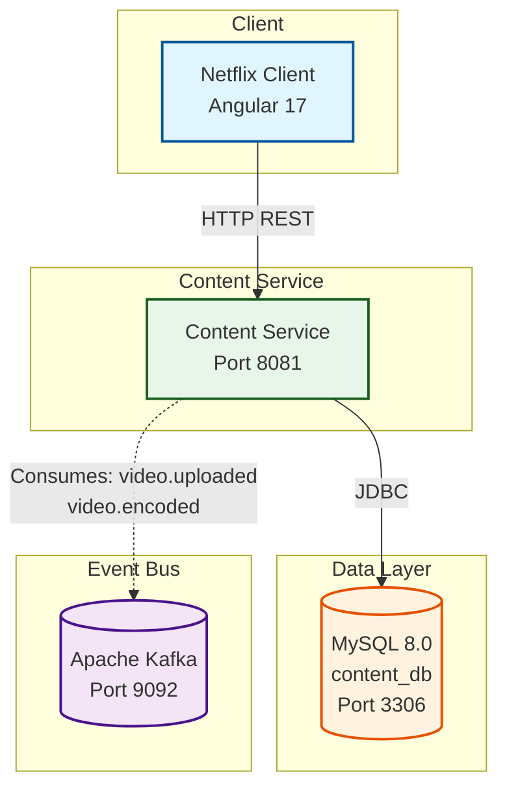

# 🎬 Content Service

> Movie catalog management microservice - handles CRUD operations for movies, genres, and video processing status updates.

<div align="center">


</div>

---

## 📋 Overview

The **Content Service** is responsible for managing the movie catalog. It provides REST endpoints for creating, retrieving, searching, and updating movies. It also consumes Kafka events to update video processing status (uploaded, encoded, failed).

## 🏗️ Architecture



## 🛠️ Technologies

| Technology | Version | Purpose |
|------------|---------|---------|
| Spring Boot | 4.1.2 | Application framework |
| Java | 21 | Programming language |
| Spring Data JPA | - | Database access |
| MySQL | 8.0 | Movie catalog persistence |
| Apache Kafka | 7.4.0 | Event consumption |
| OpenAPI / SpringDoc | 2.6.0 | API documentation |
| Lombok | 1.18.48 | Boilerplate reduction |
| Testcontainers | 1.20.0 | Integration testing |

## 📡 API Endpoints

| Method | Endpoint | Description |
|--------|----------|-------------|
| `POST` | `/api/v1/movies` | Create a new movie |
| `GET` | `/api/v1/movies` | List all movies |
| `GET` | `/api/v1/movies/{id}` | Get movie by ID |
| `GET` | `/api/v1/movies/genre/{genre}` | Get movies by genre |
| `GET` | `/api/v1/movies/search?title=...` | Search movies by title |

## 🔄 Kafka Event Consumers

| Topic | Handler | Description |
|-------|---------|-------------|
| `video.uploaded` | `consumerVideoUploadedEvent()` | Updates video key after S3 upload |
| `video.encoded` | `consumeVideoEncodedEvent()` | Updates HLS URL & status after encoding |

## ⚙️ Configuration

### application.yml

```yaml
spring:
  application:
    name: content-service
  datasource:
    url: jdbc:mysql://localhost:3306/content_db?createDatabaseIfNotExist=true
    username: root
    password: admin
    driver-class-name: com.mysql.cj.jdbc.Driver
  flyway:
    enabled: true
    locations: classpath:db/migration
    baseline-on-migrate: true
  jpa:
    hibernate:
      ddl-auto: update
    show-sql: true
  kafka:
    bootstrap-servers: localhost:9092
    consumer:
      group-id: content-service-group
      auto-offset-reset: earliest
server:
  port: 8081
```

### Environment Variables

| Variable | Description | Default |
|----------|-------------|---------|
| `MYSQL_URL` | JDBC connection URL | `jdbc:mysql://localhost:3306/content_db` |
| `MYSQL_USER` | Database username | `root` |
| `MYSQL_PASSWORD` | Database password | `admin` |
| `KAFKA_BOOTSTRAP_SERVERS` | Kafka broker address | `localhost:9092` |

## 🚀 Getting Started

### Prerequisites

- Java 21+
- MySQL 8.0 (or Docker)
- Kafka 7.4.0 (or Docker)
- Maven

### Run with Docker Compose

```bash
# From project root
docker-compose up -d mysql kafka zookeeper
```

### Run the Service

```bash
cd content-service
./mvnw spring-boot:run
```

The service will be available at `http://localhost:8081`

### Swagger UI

API documentation available at:

```
http://localhost:8081/swagger-ui/index.html
```

## 🧪 Testing

```bash
# Run unit tests
./mvnw test

# Run integration tests (requires Docker)
./mvnw verify
```

## 📁 Project Structure

```
content-service/
├── src/
│   ├── main/java/com/netflix/content/service/
│   │   ├── config/          # Kafka, CORS, Web config
│   │   ├── controller/      # ContentController
│   │   ├── dto/             # MovieRequest, MovieResponse
│   │   ├── model/           # Movie, Genre, VideoStatus
│   │   ├── repository/      # MovieRepository
│   │   ├── service/         # ContentService, VideoUploadedEncodedEventConsumer
│   │   └── ContentServiceApplication.java
│   └── test/
│       └── java/com/netflix/content/service/
├── pom.xml
└── README.md
```

---

<div align="center">
  <strong>Content Service - Part of NETFLIX-APP Microservices Platform</strong>
</div>
