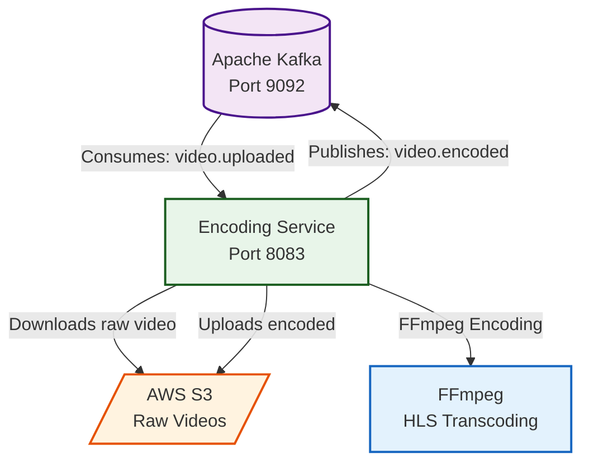

# 🎬 Encoding Service

> Video encoding microservice - consumes uploaded videos from S3, processes them with FFmpeg into HLS format, and publishes encoding completion events.

<div align="center">


</div>

---

## 📋 Overview

The **Encoding Service** is responsible for video transcoding. It consumes `video.uploaded` events from Kafka, downloads raw videos from AWS S3, encodes them using FFmpeg into HLS (HTTP Live Streaming) format with multiple resolutions, uploads the encoded segments back to S3, and publishes `video.encoded` events.

## 🏗️ Architecture



## 🛠️ Technologies

| Technology | Version | Purpose |
|------------|---------|---------|
| Spring Boot | 4.1.2 | Application framework |
| Java | 21 | Programming language |
| Spring Kafka | - | Event consumption/production |
| AWS S3 SDK | 2.42.38 | Object storage access |
| FFmpeg | Latest | Video encoding/transcoding |
| Lombok | 1.18.48 | Boilerplate reduction |

## 🔄 Kafka Event Flow

| Topic | Direction | Handler | Description |
|-------|-----------|---------|-------------|
| `video.uploaded` | Consume | `consumeVideoUploadedEvent()` | Triggered after S3 upload, starts encoding |
| `video.encoded` | Publish | `EncodingService.encodeVideo()` | Published after FFmpeg processing completes |

## ⚙️ Configuration

### application.yml

```yaml
spring:
  application:
    name: encoding-service
  kafka:
    bootstrap-servers: localhost:9092
    consumer:
      group-id: encoding-service-group
      auto-offset-reset: earliest
      value-deserializer: org.springframework.kafka.support.serializer.JsonDeserializer
      properties:
        spring:
          json:
            trusted:
              packages: "*"
            value:
              default:
                type: com.netflix.encoding.service.event.VideoUploadedEvent
    producer:
      key-serializer: org.apache.kafka.common.serialization.StringSerializer
      value-serializer: org.springframework.kafka.support.serializer.JsonSerializer
server:
  port: 8083

aws:
  access-key: ${AWS_ACCESS_KEY:YOUR_AWS_ACCESS_KEY}
  secret-key: ${AWS_SECRET_KEY:YOUR_AWS_SECRET_KEY}
  region: ${AWS_REGION:eu-north-1}
  s3:
    bucket-name: ${AWS_BUCKET_NAME:netflix-streaming-videos-005723479002-eu-north-1-an}

ffmpeg:
  path: ${FFMPEG_PATH:C:/ffmpeg/bin/ffmpeg.exe}

encoding:
  temp-dir: ${TEMP_DIR:C:/temp/encoding}
```

### Environment Variables

| Variable | Description | Default |
|----------|-------------|---------|
| `AWS_ACCESS_KEY` | AWS access key | `YOUR_AWS_ACCESS_KEY` |
| `AWS_SECRET_KEY` | AWS secret key | `YOUR_AWS_SECRET_KEY` |
| `AWS_REGION` | AWS region | `eu-north-1` |
| `AWS_BUCKET_NAME` | S3 bucket name | `netflix-streaming-videos-...` |
| `FFMPEG_PATH` | FFmpeg binary path | `C:/ffmpeg/bin/ffmpeg.exe` |
| `TEMP_DIR` | Temporary encoding directory | `C:/temp/encoding` |
| `KAFKA_BOOTSTRAP_SERVERS` | Kafka broker address | `localhost:9092` |

## 🚀 Getting Started

### Prerequisites

- Java 21+
- Kafka 7.4.0
- AWS Account with S3 bucket
- FFmpeg installed
- Maven

### Run the Service

```bash
cd encoding-service
./mvnw spring-boot:run
```

The service will be available at `http://localhost:8083`

## 📁 Project Structure

```
encoding-service/
├── src/
│   ├── main/java/com/netflix/encoding/service/
│   │   ├── config/          # S3Config
│   │   ├── event/           # VideoEncodedEvent, VideoUploadedEvent
│   │   ├── service/         # EncodingService, VideoEventConsumer
│   │   └── EncodingServiceApplication.java
│   └── test/
│       └── java/com/netflix/encoding/service/
├── pom.xml
└── README.md
```

---

<div align="center">
  <strong>Encoding Service - Part of NETFLIX-APP Microservices Platform</strong>
</div>