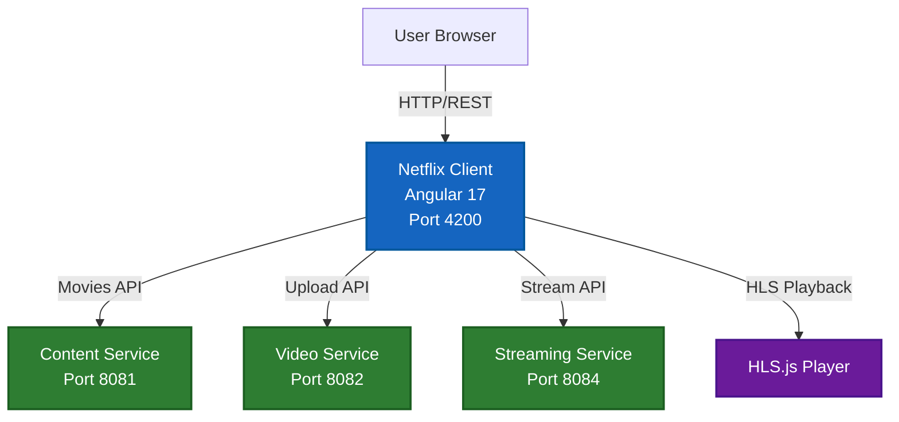

# 🎬 Netflix Client

> Angular frontend application for the NETFLIX-APP streaming platform. Provides a modern UI for browsing movies, uploading videos, and streaming HLS content.

<div align="center">


</div>

---

## 📋 Overview

The **Netflix Client** is an Angular 17 single-page application that provides the user interface for the streaming platform. Users can browse the movie catalog, search by title or genre, upload videos, and stream content using HLS.js for adaptive bitrate streaming.

## 🏗️ Architecture



## 🛠️ Technologies

| Technology | Version | Purpose |
|------------|---------|---------|
| Angular | 17.3 | Frontend framework |
| TypeScript | 5.4 | Programming language |
| HLS.js | 1.5.7 | HLS video playback |
| RxJS | 7.8 | Reactive programming |
| Karma/Jasmine | - | Unit testing |

## 📡 API Integration

| Service | Base URL | Endpoints Used |
|---------|----------|----------------|
| Content Service | `http://localhost:8081` | `/api/v1/movies` |
| Video Service | `http://localhost:8082` | `/api/v1/videos/upload/{id}` |
| Streaming Service | `http://localhost:8084` | `/api/v1/stream/{id}` |

## 🚀 Getting Started

### Prerequisites

- Node.js 18+
- npm or yarn
- Angular CLI 17.3

### Installation

```bash
cd netflix-client
npm install
```

### Development Server

```bash
ng serve
```

Navigate to `http://localhost:4200/`. The app will automatically reload on changes.

### Code Scaffolding

```bash
ng generate component component-name
ng generate directive|pipe|service|class|guard|interface|enum|module
```

### Build

```bash
ng build
```

Build artifacts stored in `dist/`.

### Running Unit Tests

```bash
ng test
```

Tests run via Karma.

### Running End-to-End Tests

```bash
ng e2e
```

Requires an E2E testing package to be added first.

## 📁 Project Structure

```
netflix-client/
├── src/
│   ├── app/
│   │   ├── components/
│   │   ├── services/
│   │   ├── models/
│   │   └── app.component.ts
│   ├── assets/
│   └── environments/
├── angular.json
├── package.json
├── tsconfig.json
├── tsconfig.app.json
├── tsconfig.spec.json
└── README.md
```

## 🔗 Related Services

- [Content Service](../content-service/README.md) - Movie catalog API
- [Video Service](../video-service/README.md) - Video upload API
- [Streaming Service](../streaming-service/README.md) - Streaming URL API

---

<div align="center">
  <strong>Netflix Client - Part of NETFLIX-APP Microservices Platform</strong>
</div>
