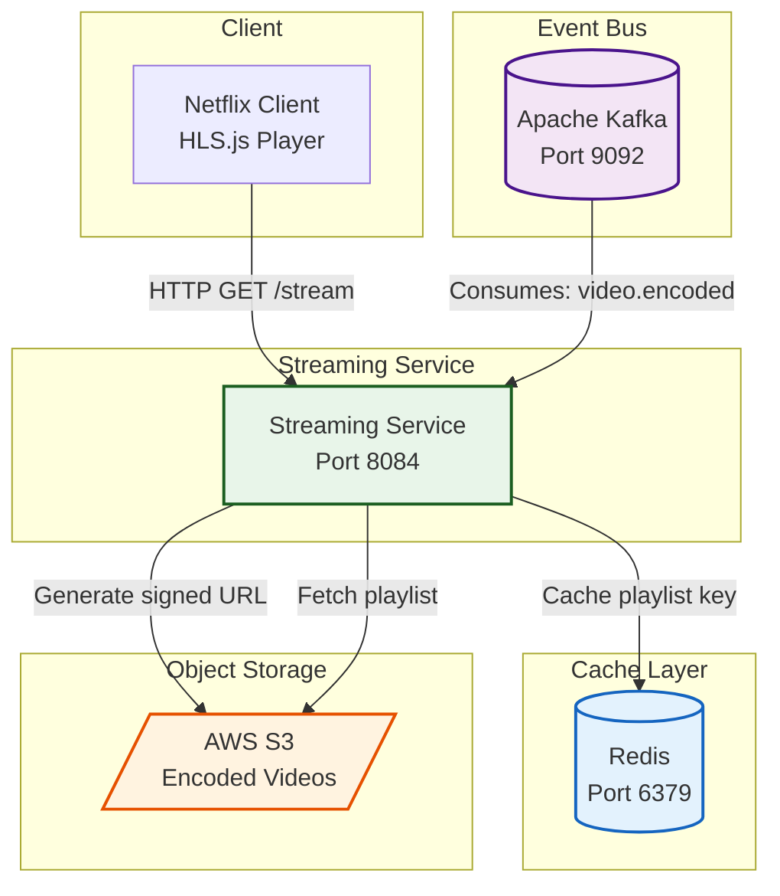

# 🎬 Streaming Service

> HLS streaming microservice - provides signed streaming URLs and signed HLS playlists for video playback, with Redis caching for performance.

<div align="center">


</div>

---

## 📋 Overview

The **Streaming Service** is responsible for delivering streaming content to clients. It consumes `video.encoded` events from Kafka to cache master playlist keys in Redis, generates signed URLs for S3 objects, and serves signed HLS playlists for HLS.js video players.

## 🏗️ Architecture



## 🛠️ Technologies

| Technology | Version | Purpose |
|------------|---------|---------|
| Spring Boot | 4.1.2 | Application framework |
| Java | 21 | Programming language |
| Spring Data Redis | - | Streaming URL cache |
| Apache Kafka | 7.4.0 | Event consumption |
| AWS S3 SDK | 2.21.0 | Object storage access |
| OpenAPI / SpringDoc | 2.6.0 | API documentation |
| Lombok | 1.18.48 | Boilerplate reduction |

## 🔄 Kafka Event Consumers

| Topic | Handler | Description |
|-------|---------|-------------|
| `video.encoded` | `consumeVideoEncodedEvent()` | Caches master playlist key in Redis |

## 📡 API Endpoints

| Method | Endpoint | Description |
|--------|----------|-------------|
| `GET` | `/api/v1/stream/{movieId}` | Get signed streaming URL for HLS master playlist |
| `GET` | `/api/v1/stream/{movieId}/playlist?path=...` | Get signed HLS playlist content |

## ⚙️ Configuration

### application.yml

```yaml
spring:
  application:
    name: streaming-service
  data:
    redis:
      host: localhost
      port: 6379
  kafka:
    bootstrap-servers: localhost:9092
    consumer:
      group-id: streaming-service-group
      auto-offset-reset: earliest
server:
  port: 8084

aws:
  access-key: ${AWS_ACCESS_KEY:YOUR_AWS_ACCESS_KEY}
  secret-key: ${AWS_SECRET_KEY:YOUR_AWS_SECRET_KEY}
  region: ${AWS_REGION:eu-north-1}
  s3:
    bucket-name: ${AWS_BUCKET_NAME:netflix-streaming-videos-005723479002-eu-north-1-an}
    presigned-url-expiry: 60
```

### Environment Variables

| Variable | Description | Default |
|----------|-------------|---------|
| `AWS_ACCESS_KEY` | AWS access key | `YOUR_AWS_ACCESS_KEY` |
| `AWS_SECRET_KEY` | AWS secret key | `YOUR_AWS_SECRET_KEY` |
| `AWS_REGION` | AWS region | `eu-north-1` |
| `AWS_BUCKET_NAME` | S3 bucket name | `netflix-streaming-videos-...` |
| `REDIS_HOST` | Redis host | `localhost` |
| `REDIS_PORT` | Redis port | `6379` |
| `KAFKA_BOOTSTRAP_SERVERS` | Kafka broker address | `localhost:9092` |

## 🚀 Getting Started

### Prerequisites

- Java 21+
- Redis 6+
- Kafka 7.4.0
- AWS Account with S3 bucket
- Maven

### Run the Service

```bash
cd streaming-service
./mvnw spring-boot:run
```

The service will be available at `http://localhost:8084`

### Swagger UI

API documentation available at:

```
http://localhost:8084/swagger-ui/index.html
```

## 📁 Project Structure

```
streaming-service/
├── src/
│   ├── main/java/com/netflix/streaming/service/
│   │   ├── config/          # AppConfig, CorsFilter, KafkaConfig
│   │   ├── controller/      # StreamingController
│   │   ├── dto/             # StreamingResponse
│   │   ├── event/           # VideoEncodedEvent
│   │   ├── service/         # StreamingService, VideoEncodedEventConsumer
│   │   └── StreamingServiceApplication.java
│   └── test/
│       └── java/com/netflix/streaming/service/
├── pom.xml
└── README.md
```

---

<div align="center">
  <strong>Streaming Service - Part of NETFLIX-APP Microservices Platform</strong>
</div>
