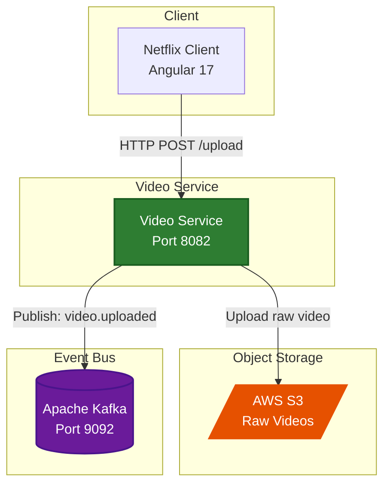

# 🎬 Video Service

> Video upload microservice - handles multipart video file uploads to AWS S3 and publishes encoding trigger events to Kafka.

<div align="center">


</div>

---

## 📋 Overview

The **Video Service** is responsible for handling video file uploads. It accepts multipart file uploads via REST API, stores raw videos in AWS S3, and publishes `video.uploaded` events to Kafka to trigger the encoding pipeline.

## 🏗️ Architecture



## 🛠️ Technologies

| Technology | Version | Purpose |
|------------|---------|---------|
| Spring Boot | 4.1.2 | Application framework |
| Java | 21 | Programming language |
| Spring MVC | - | REST controller |
| Apache Kafka | 7.4.0 | Event production |
| AWS S3 SDK | 2.42.38 | Object storage access |
| OpenAPI / SpringDoc | 2.6.0 | API documentation |
| Lombok | 1.18.48 | Boilerplate reduction |

## 📡 API Endpoints

| Method | Endpoint | Description |
|--------|----------|-------------|
| `POST` | `/api/v1/videos/upload/{movieId}` | Upload video file to S3 (multipart) |

## 🔄 Kafka Event Producers

| Topic | Publisher | Description |
|-------|-----------|-------------|
| `video.uploaded` | `VideoService.uploadVideo()` | Published after successful S3 upload |

## ⚙️ Configuration

### application.yml

```yaml
spring:
  application:
    name: video-service
  kafka:
    bootstrap-servers: localhost:9092
    producer:
      key-serializer: org.apache.kafka.common.serialization.StringSerializer
      value-serializer: org.springframework.kafka.support.serialization.JsonSerializer
  servlet:
    multipart:
      max-file-size: 2GB
      max-request-size: 2GB
server:
  port: 8082

aws:
  access-key: ${AWS_ACCESS_KEY:YOUR_AWS_ACCESS_KEY}
  secret-key: ${AWS_SECRET_KEY:YOUR_AWS_SECRET_KEY}
  region: ${AWS_REGION:eu-north-1}
  s3:
    bucket-name: ${AWS_BUCKET_NAME:netflix-streaming-videos-005723479002-eu-north-1-an}
```

### Environment Variables

| Variable | Description | Default |
|----------|-------------|---------|
| `AWS_ACCESS_KEY` | AWS access key | `YOUR_AWS_ACCESS_KEY` |
| `AWS_SECRET_KEY` | AWS secret key | `YOUR_AWS_SECRET_KEY` |
| `AWS_REGION` | AWS region | `eu-north-1` |
| `AWS_BUCKET_NAME` | S3 bucket name | `netflix-streaming-videos-...` |
| `KAFKA_BOOTSTRAP_SERVERS` | Kafka broker address | `localhost:9092` |

## 🚀 Getting Started

### Prerequisites

- Java 21+
- Kafka 7.4.0
- AWS Account with S3 bucket
- Maven

### Run the Service

```bash
cd video-service
./mvnw spring-boot:run
```

The service will be available at `http://localhost:8082`

### Swagger UI

API documentation available at:

```
http://localhost:8082/swagger-ui/index.html
```

## 📁 Project Structure

```
video-service/
├── src/
│   ├── main/java/com/netflix/video/service/
│   │   ├── config/          # CorsFilter, CorsResponseAdvice, KafkaConfig, S3Config
│   │   ├── controller/      # VideoController
│   │   ├── event/           # VideoUploadedEvent
│   │   ├── service/         # VideoService
│   │   └── VideoServiceApplication.java
│   └── test/
│       └── java/com/netflix/video/service/
├── pom.xml
└── README.md
```

---

<div align="center">
  <strong>Video Service - Part of NETFLIX-APP Microservices Platform</strong>
</div>
